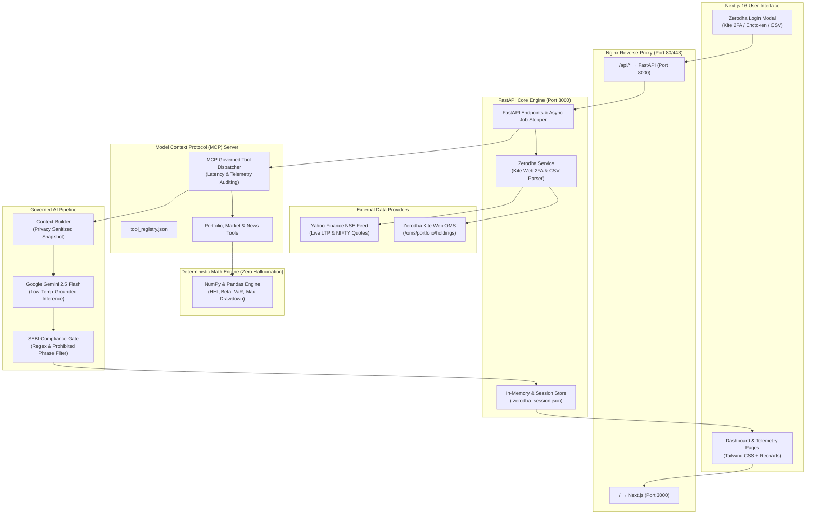
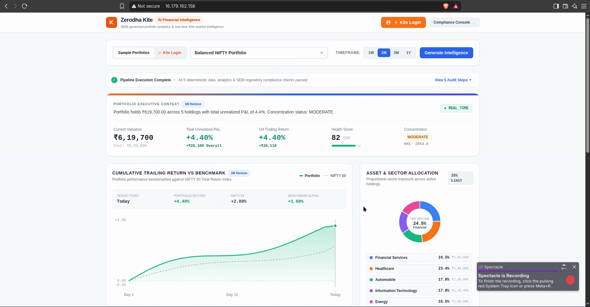
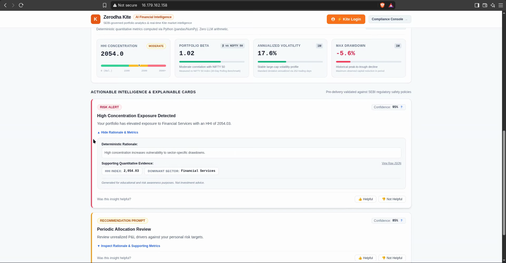
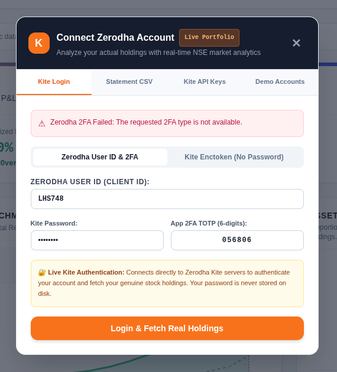

# Zerodha AI Financial Intelligence Platform

> **An institutional-grade, SEBI-governed portfolio intelligence and quantitative risk analytics platform built with FastAPI, Next.js 16, Model Context Protocol (MCP), and Google Gemini 2.5 Flash.**

## 🔗 Project Links

[](http://16.179.162.158)
[](https://github.com/crushervp/zerodha-ai-financial-intelligence-platform)
[](http://16.179.162.158/docs)
[](#11-live-demo--video-links)

---

## 1. Project Overview

The **Zerodha AI Financial Intelligence Platform** bridges the gap between raw brokerage account data and explainable portfolio risk management for Indian retail equity investors. 

Retail investors on discount brokerages like Zerodha frequently manage substantial personal capital without institutional risk tools. Most retail dashboards display only nominal Profit & Loss (P&L) numbers, obscuring dangerous single-stock concentrations, sector drift, high market beta, and extreme drawdown risks.

This platform connects directly to **Zerodha Kite Web** (supporting 2FA TOTP/App Code, Enctoken, and Console CSV statements), enriches holdings with real-time NSE market quotes, deterministically computes quantitative risk metrics (HHI, Beta, VaR, Max Drawdown) via Python (`pandas`/`NumPy`), and passes this strictly governed context through **Model Context Protocol (MCP)** tools to **Gemini 2.5 Flash**. The output is an explainable executive briefing accompanied by practical, numbered **action steps** (rebalancing rules, trailing stop-losses, and tax-loss harvesting) governed by an automated **SEBI Regulatory Compliance Gate**.

---

## 2. Business Problem

1. **The Retail Concentration Blindspot**: Retail stock market participation in India has surged, yet over 80% of retail investors hold highly concentrated, unbalanced portfolios (e.g., >60% of capital tied up in a single sector like Banking, or 100% in a single large-cap).
2. **Cognitive Biases & The "Tip" Culture**: Retail traders often rely on unverified social media tips, chase speculative high-beta turnaround plays, or panic-sell during routine index pullbacks because standard terminals do not provide explainable rationale or drawdown context.
3. **SEBI Regulatory Constraints (RIA / RA Rules)**: Under SEBI (Investment Advisers) Regulations, 2013 and Research Analyst guidelines, automated platforms cannot issue unconditional, direct buy/sell trade calls or promise guaranteed returns. Commercial AI platforms must implement strict regulatory safety gates before delivering insights.
4. **Broker Data Ingestion Barrier**: Non-developer retail investors cannot easily access developer Kite Connect APIs (which require paid developer subscriptions). Investors need flexible, zero-friction ingestion paths: web login, 2FA, session enctokens, or drag-and-drop Console statement CSVs.

---

## 3. Product Goal

- **Democratize Institutional Risk Analytics**: Deliver quantitative risk metrics (HHI Concentration Index, Beta vs NIFTY 50, Annualized Volatility, 95% Parametric VaR, Historical Drawdown) directly to retail investors.
- **Zero-Hallucination Architecture**: Strictly decouple arithmetic from language models. 100% of numerical calculations are executed deterministically in Python; the LLM is restricted to narrative explanation and contextual synthesis.
- **Concrete Actionability**: Replace generic advice with prioritized, practical action steps (e.g., phased rebalance tranches, GTT trailing stop-loss triggers, sector rotation targets, tax-loss offsets).
- **SEBI-Compliant Pre-Delivery Gate**: Programmatically intercept and sanitize prohibited phrases ("guaranteed returns", "must buy", "target price") before cards reach the UI.

---

## 4. Key Features

- 🔐 **Live Zerodha Kite Web Authentication**: Real-time 2FA login (supporting both mobile Kite App Code & TOTP), session Enctoken authentication, and Zerodha Console CSV statement parsing.
- 📐 **Deterministic Math Engine**: Vectorized Python arithmetic computing HHI concentration, portfolio beta, maximum drawdown, and sector weights without LLM hallucination.
- 🔌 **Model Context Protocol (MCP) Integration**: Governed functional tool execution layer (`mcp_server`) that audits all tool calls, arguments, payloads, and latency in milliseconds.
- ⚡ **Actionable Intelligence & Implementation Checklists**: Custom cards categorized into `RISK_ALERT`, `RECOMMENDATION_PROMPT`, and `EDUCATIONAL_INSIGHT` with numbered, copyable action steps.
- 📊 **Interactive Net-Worth Trajectory & Sector Visualizations**: Recharts-powered performance curve across multi-timeframe views (`1W`, `1M`, `3M`, `1Y`) benchmarked against NIFTY 50, paired with an interactive sector donut chart featuring 35% breach alerts.
- 🛡️ **Automated SEBI Compliance Gate**: Pre-delivery regex and semantic scanner blocking unsolicited trade directives or return guarantees.
- 📡 **Operations & Telemetry Console (`/operations`)**: Real-time observability dashboard tracking pipeline execution stats, tool call latency, and compliance audit snapshots.

---

## 5. Architecture Diagram & Explanation



### Architecture Highlights:
1. **Nginx Reverse Proxy**: Serves frontend routes from Next.js (port 3000) and proxies `/api/*` to FastAPI (port 8000). Resolves CORS entirely and prevents mixed-content issues.
2. **Decoupled Math vs. Narrative**: Numbers are computed in pure Python using NumPy and Pandas. The LLM only receives read-only numbers and focuses strictly on explanation.
3. **Audit Trail**: Every MCP tool execution is logged with millisecond timestamps and argument hashes for audit compliance.

---

## 6. AI Workflow Explanation

When an investor clicks **Generate Intelligence**, the platform executes an asynchronous 6-stage lifecycle stepper:

```
[1. PENDING] ──► [2. FETCHING_DATA] ──► [3. RUNNING_ANALYTICS] ──► [4. GENERATING_EXPLANATION] ──► [5. VALIDATING_OUTPUT] ──► [6. COMPLETED]
```

1. **Stage 1: `PENDING`** — The backend creates a unique `job_id` and registers the task in the background queue.
2. **Stage 2: `FETCHING_DATA`** — Ingests user holdings (via active Zerodha Kite session, uploaded CSV, or sample profile) and retrieves real-time NSE market quotes and stock-specific news signals via MCP tools.
3. **Stage 3: `RUNNING_ANALYTICS`** — The deterministic Python engine calculates:
   - **HHI Index**: Measures diversification across holdings ($HHI = \sum w_i^2$).
   - **Portfolio Beta ($\beta$)**: Weighted covariance against the Nifty 50 Total Return Index.
   - **Annualized Volatility & Drawdown**: Historical variance and maximum peak-to-trough drop.
   - **Sector Exposure**: Proportional weights with automatic alerts on $>35\%$ concentration.
4. **Stage 4: `GENERATING_EXPLANATION`** — The sanitized context dictionary is passed to **Gemini 2.5 Flash** (temperature `0.2`) with system instructions enforcing strict factual grounding, portfolio health scoring, and actionable step synthesis.
5. **Stage 5: `VALIDATING_OUTPUT`** — The pre-delivery **SEBI Compliance Gate** ([`validator.py`](ai_workflows/validation/validator.py)) verifies JSON structure, checks confidence scores, and scans against prohibited advice patterns.
6. **Stage 6: `COMPLETED`** — The validated insights and action checklists are persisted and rendered in the dashboard.

---

## 7. Tools and Technologies Used

| Layer | Technologies | Purpose |
| :--- | :--- | :--- |
| **Frontend UI** | **Next.js 16** (App Router, Turbopack), **TypeScript**, **Tailwind CSS** | Responsive financial terminal user interface |
| **Charts & Data Viz** | **Recharts**, **Lucide React** | Interactive net-worth trajectory curves & sector donut charts |
| **Backend API** | **FastAPI**, **Uvicorn**, **Python 3.11/3.14**, **Pydantic v2** | High-performance async ASGI API and data validation |
| **Math & Analytics** | **NumPy**, **Pandas** | Deterministic financial arithmetic (Zero Hallucination) |
| **AI & LLM** | **Google Gemini 2.5 Flash** (`google-genai`), **MCP** | Explainable narrative generation and governed tool dispatch |
| **Broker Integration** | **Zerodha Kite Web API**, **Zerodha Console CSV Parser** | Ingestion of live Demat holdings, 2FA auth, and statement files |
| **Market Data** | **Yahoo Finance API** (`query1.finance.yahoo.com`), **NSE Feeds** | Real-time stock quotes, day changes, and NIFTY 50 benchmarks |
| **Testing** | **Pytest**, **AnyIO** | Automated test suites (analytics, API, MCP, and 2FA login) |
| **DevOps & Cloud** | **Docker**, **Docker Compose**, **Nginx**, **AWS EC2** (Ubuntu 24.04) | Production containerization, reverse proxying, and cloud hosting |

---

## 8. Data Sources Used

1. **Zerodha Kite Web OMS**:
   - `/api/login` & `/api/twofa` — Authenticates user credentials with dynamic `app_code` and `totp` detection.
   - `/oms/portfolio/holdings` — Retrieves active CNC equity delivery holdings from Demat.
   - `/oms/portfolio/positions` — Ingests open trade positions.
2. **Zerodha Console Statements**:
   - Official CSV export format (`Holdings-<ClientID>.csv`), parsing trading symbols, ISINs, quantities, buy prices, and current valuations.
3. **NSE India via Yahoo Finance**:
   - Live ticker feeds (`{symbol}.NS`) supplying Last Traded Price (LTP), day high/low, day change %, and volume.
   - Benchmark ticker (`^NSEI` - NIFTY 50) for market beta and relative performance calculations.
4. **Curated Corporate Actions & Financial News**:
   - Structured news feed ([`data/sample_news_signals.csv`](data/sample_news_signals.csv)) covering earnings revisions, regulatory orders, and sector updates.

---

## 9. How to Run Locally

### Prerequisites
- **Python 3.11+**
- **Node.js 18+** (LTS v20 or v22 recommended)
- **Git**

### Step 1: Clone the Repository
```bash
git clone https://github.com/crushervp/zerodha-ai-financial-intelligence-platform.git
cd zerodha-ai-financial-intelligence-platform
```

### Step 2: Backend Setup
```bash
# 1. Create and activate a Python virtual environment
python3 -m venv env
source env/bin/activate       # On Linux/macOS
# or: env\Scripts\activate    # On Windows

# 2. Install dependencies
pip install -r requirements.txt

# 3. Configure environment variables
cp .env.example .env
# Edit .env to supply your GEMINI_API_KEY (optional; deterministic fallback mode active by default)

# 4. Run automated test suites
PYTHONPATH=. pytest tests/ -v

# 5. Start the FastAPI server
PYTHONPATH=. python -m uvicorn backend.main:app --host 0.0.0.0 --port 8000 --reload
```

### Step 3: Frontend Setup
In a new terminal window:
```bash
cd frontend

# 1. Install dependencies
npm install

# 2. Start Next.js development server
npm run dev
```

Open [**http://localhost:3000**](http://localhost:3000) in your browser.

---

## 10. Environment Variables

The application reads configuration from `.env` in the root directory:

| Variable | Required | Default | Description |
| :--- | :---: | :--- | :--- |
| `GEMINI_API_KEY` | Optional | `""` | Google Gemini API key for live LLM explanations (falls back to deterministic engine if not set) |
| `LLM_MODEL` | No | `gemini-2.5-flash` | Gemini model variant for generation |
| `PORT` | No | `8000` | Port for FastAPI backend |
| `ENVIRONMENT` | No | `development` | Runtime environment (`development` / `production`) |
| `CORS_ORIGINS` | No | `*` | Comma-separated list of allowed origins |
| `DATABASE_URL` | No | `sqlite:///./platform.db` | Persistence database connection string |
| `ZERODHA_SESSION_CACHE_FILE` | No | `.zerodha_session.json` | Path to cached encrypted Zerodha session token |
| `NEXT_PUBLIC_API_BASE` | No | `""` (dynamic) | Backend URL (auto-detects port 3000 vs. Nginx reverse proxy) |

---

## 11. Live Demo & Video Links

The platform is deployed live on **AWS EC2 (Mumbai Region `ap-south-1`)**:

- 🌐 **Live Web Application:** [**http://16.179.162.158**](http://16.179.162.158)
- ⚙️ **Interactive OpenAPI Docs:** [**http://16.179.162.158/docs**](http://16.179.162.158/docs)
- 📊 **Operations & Compliance Console:** [**http://16.179.162.158/operations**](http://16.179.162.158/operations)
- 🎥 **Video Walkthrough:** *(Insert video demo URL here)*

---

## 12. Screenshots

### 1. Executive Portfolio Dashboard & Net-Worth Trajectory
*Visualizing portfolio valuation, health score (82/100), NIFTY 50 benchmark comparison, and sector concentration.*



---

### 2. Differentiated Actionable Intelligence & Implementation Checklists
*Explainable cards with strategy badges, confidence tooltips, deterministic evidence, and concrete, numbered action checklists.*



---

### 3. Zerodha Kite Interactive Authentication Modal
*Multi-tab ingestion: Live Kite login with dynamic 2FA detection (App Code/TOTP), session Enctoken, Console CSV upload, and demo profiles.*



---

## 13. API Details

The FastAPI backend exposes fully typed REST endpoints:

| Method | Endpoint | Description | Key Parameters |
| :--- | :--- | :--- | :--- |
| `POST` | `/api/portfolio-analysis` | Initiates asynchronous portfolio intelligence pipeline | `{"portfolio_id": "...", "timeframe": "1M"}` |
| `GET` | `/api/insights/{job_id}` | Polls pipeline execution status and returns insight cards | Path param: `job_id` |
| `POST` | `/api/zerodha/login` | Connects live Kite account (User ID + Password + 2FA / Enctoken / Demo) | `{"mode": "REAL", "user_id": "...", "password": "...", "twofa_value": "..."}` |
| `POST` | `/api/zerodha/upload-csv` | Parses uploaded Zerodha Console/Kite statement CSV | Multipart file upload |
| `GET` | `/api/zerodha/session` | Returns active Zerodha connection details and holdings count | None |
| `POST` | `/api/zerodha/sync-live-market` | Enriches Demat holdings with real-time NSE market quotes | None |
| `POST` | `/api/zerodha/logout` | Disconnects active session and clears disk cache | None |
| `POST` | `/api/mcp/tools/execute` | Executes registered MCP tool with millisecond telemetry | `{"tool_name": "...", "parameters": {...}}` |
| `POST` | `/api/feedback` | Records user helpfulness vote on insight cards | `{"card_id": "...", "action": "HELPFUL"}` |
| `GET` | `/api/operations/metrics` | Operational telemetry (jobs completed, tool latency, feedback) | None |
| `GET` | `/api/compliance/audit/{job_id}` | Retrieves compliance snapshots and raw tool logs | Path param: `job_id` |

#### Sample Request (`POST /api/portfolio-analysis`):
```json
{
  "portfolio_id": "port_diversified_01",
  "timeframe": "1M"
}
```

#### Sample Response (`GET /api/insights/job_df494bc0`):
```json
{
  "job_id": "job_df494bc0",
  "status": "COMPLETED",
  "insights": {
    "portfolio_id": "port_diversified_01",
    "summary": "Portfolio holds ₹619,700.00 across 5 holdings with total unrealized P&L of 4.4%. Concentration status: MODERATE.",
    "portfolio_health_score": 75.0,
    "key_drivers": [
      {
        "symbol": "SUNPHARMA",
        "impact_pct": 37.93,
        "direction": "POSITIVE",
        "rationale": "Leading contributor to overall portfolio gain/loss."
      }
    ],
    "recommendation_cards": [
      {
        "card_id": "port_diversified_01_profit_management",
        "category": "RECOMMENDATION_PROMPT",
        "action_type": "PROFIT_BOOKING",
        "title": "Profit Realization Strategy: SUNPHARMA",
        "summary": "SUNPHARMA is your primary outperformer, generating ₹9,900 (+37.9% P&L contribution). Protect your paper gains.",
        "rationale": "Leading winners often experience mean-reversion pullbacks. A disciplined partial profit strategy locks in capital gains without exiting the entire trend.",
        "action_steps": [
          "Partial Profit Taking: Consider booking 20-25% of your position in SUNPHARMA to recover invested capital and lock in gains.",
          "Raise Trailing Stop: Update your GTT stop-loss trigger on Zerodha Kite for SUNPHARMA to protect accumulated profits against sudden reversals.",
          "Reinvest into Laggard Compounders: Deploy harvested profits into quality large-caps trading near their 200-day moving average support."
        ],
        "supporting_metrics": {
          "top_performer": "SUNPHARMA",
          "unrealized_gain": 9900.0,
          "pnl_contribution_pct": 37.93
        },
        "confidence": 0.91,
        "disclaimer": "Generated for educational and risk awareness purposes. Not investment advice."
      }
    ]
  }
}
```

---

## 14. Evaluation Approach

The platform's reliability and governance are verified across three testing dimensions:

1. **Deterministic Arithmetic Precision (Zero Hallucination)**:
   - Automated unit tests in [`tests/analytics_tests/test_analytics.py`](tests/analytics_tests/test_analytics.py) verify that stock weights sum exactly to 100.0%, HHI calculations match mathematical definitions ($HHI = \sum w_i^2$), and sector allocations correctly trigger breach thresholds.
2. **SEBI Compliance & Safety Guardrails**:
   - Automated test suite in [`tests/ai_output_tests/test_ai_workflow.py`](tests/ai_output_tests/test_ai_workflow.py) injects prohibited advice phrases (*"guaranteed return"*, *"must buy immediately"*, *"target price"*) and verifies that the pre-delivery gate intercepts and rejects non-compliant payloads.
3. **Live Functional Integration & Authentication**:
   - Tests in [`tests/functional_tests/test_zerodha_login.py`](tests/functional_tests/test_zerodha_login.py) validate demo accounts, Console statement CSV parsing, error handling for empty Demat delivery accounts, and real Kite Web 2FA payload structures.
   - All **19 automated pytest suites** pass with zero regressions.

---

## 15. Known Limitations

- **Delivery (CNC) Focus**: The platform is optimized for settled delivery equity holdings in Demat. Intraday (MIS), futures, and options contracts are currently excluded from risk scoring.
- **External Quote Rate Limits**: During peak trading hours, free-tier quote queries to public market feeds may experience rate limiting; the system applies a fallback to cached session quotes.
- **Broker Session Lifecycle**: Per Indian stock exchange cybersecurity standards, Zerodha Kite Web sessions expire daily at approximately 06:00 AM IST, requiring users to re-authenticate periodically.

---

## 16. Team Contributions

- **Vidyadhar Patil** ([@crushervp](https://github.com/crushervp))
  - Full-Stack System Architecture, Zerodha Kite 2FA Ingestion Service, Deterministic Quantitative Math Engine, Model Context Protocol (MCP) Governance, SEBI Compliance Gate, Next.js UI Design & Data Visualizations, AWS EC2 Docker Deployment.
- **Kumar Somashekhar** ([@kumarsomashekhar](https://github.com/kumarsomashekhar))
  - Frontend UI/UX enhancements, Badges & Project documentation, Deployment validation and testing.
- **Vijay Kumar Edukula**
  - Backend API testing, Quantitative analytics validation, Risk metric edge-case evaluation.
- **Sneha Kumbhar**
  - SEBI compliance policy research, Prohibited phrase regex definition, Educational disclaimer design.
- **Abhishek Thakur**
  - Data pipeline design, Sample portfolio & market dataset curation, Telemetry log validation.
